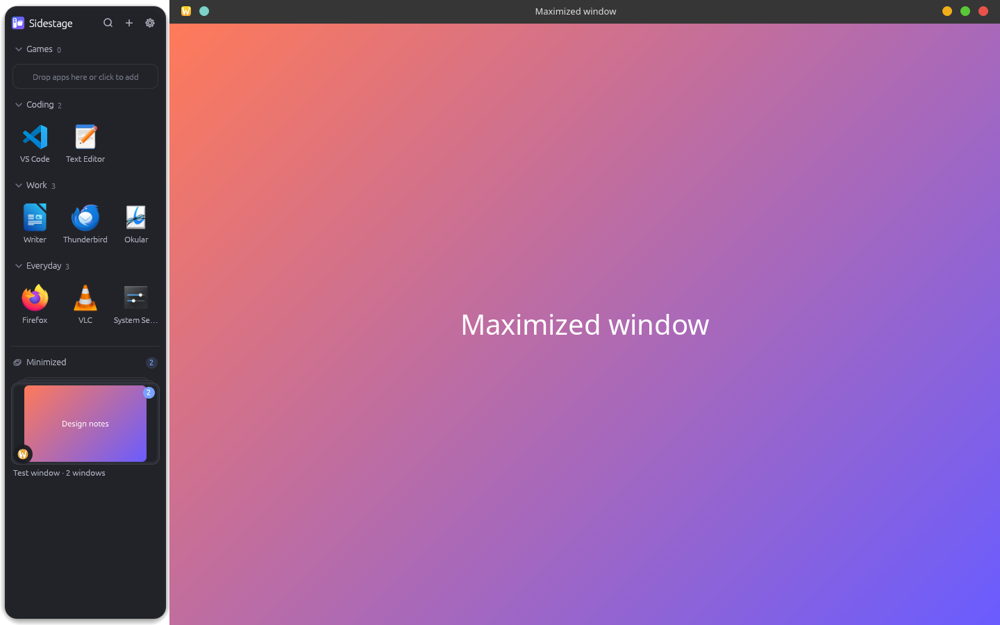
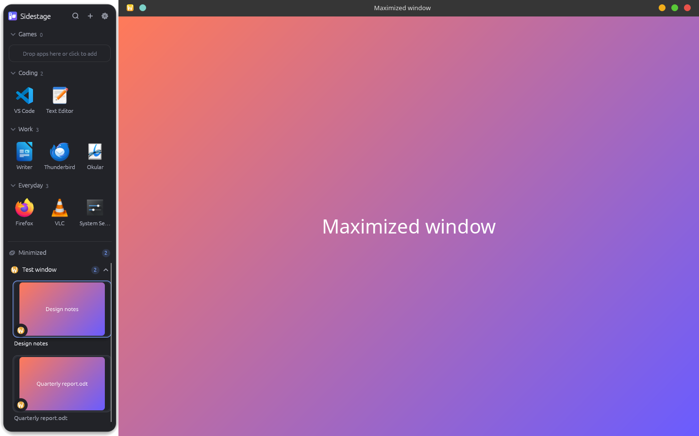
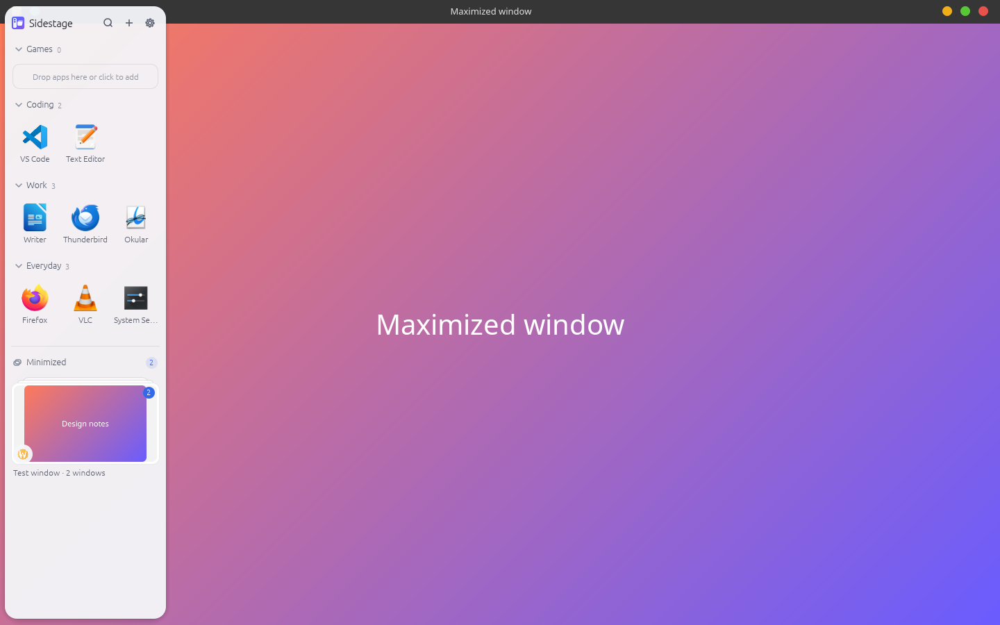
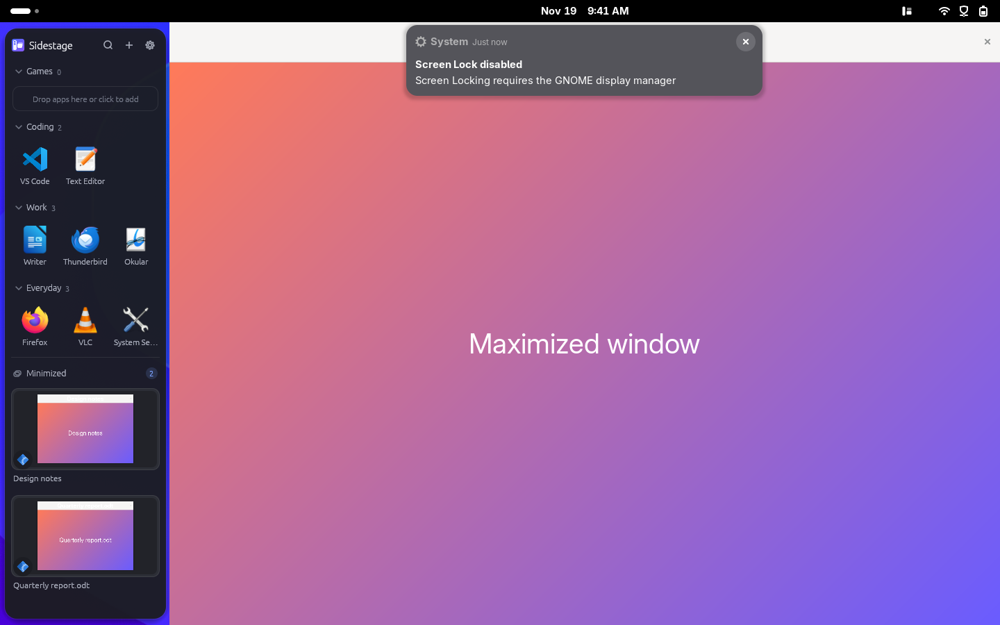
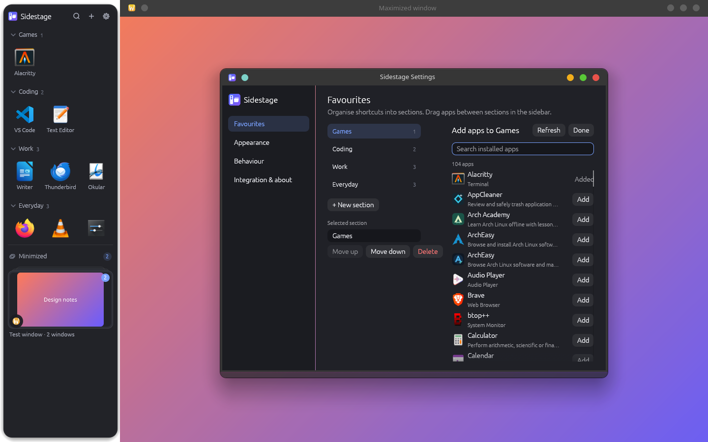

# Sidestage

A sidebar for **Windows 11** and **Linux** (GNOME and KDE Plasma first), inspired
by macOS Stage Manager but organised your way:

1. **Favourite apps** at the top, in expandable sections (Games, Coding, Work,
   Everyday, or your own).
2. **Minimized windows** underneath, as preview cards, so a minimized window is
   one click away without crowding the taskbar or dock.

Sidestage does **not** hide or rearrange other windows when you switch apps.
It only lists windows you minimize yourself.

| KDE Plasma (dark, minimized windows stacked per app) | Expanded stack |
|---|---|
|  |  |
| **Light theme, auto-hide revealed** | **GNOME Shell 51 with the extension** |
|  |  |



## Features

**Favourites**
- Sections you can create, rename, reorder, collapse and delete (deleting asks
  whether to keep the apps by moving them to another section).
- Add apps from the installed-apps picker (Start menu / AppsFolder on Windows,
  `.desktop` entries on Linux, with search). You can also choose a file or program,
  or drag a shortcut, `.exe`, `.lnk` or `.desktop` file onto the sidebar.
- Drag favourites to reorder them or move them between sections. You can also
  use right-click → *Move to*.
- Click to launch. Custom names and icons (an image file, a program's icon, or
  an icon-theme name on Linux).
- **Launch section:** right-click a section header → *Launch section* to open
  all its favourites in order. Failures don't stop the batch and are
  reported. Turn off *Include in section launch* for favourites that should
  only open on click.
- **Folders and websites:** *Add folder…* / *Add website…* in the section
  menu or in Settings. Dropped folders, Windows `.url` files and Linux link
  `.desktop` files also work. Folders open in the file manager, sites in
  the default browser (http/https only).
- Favourites are shortcuts, so they stay put whether the app is running or not.

**Minimized windows**
- A card appears only when you minimize a window. It shows a preview, the app
  icon and the window title, and disappears when the window is restored or
  closed.
- Click to restore and focus that exact window. Right-click a stack →
  *Restore all windows* (the most recently minimized ends up focused).
- Several minimized windows from one app form a stack; click to expand it.
- Previews are live on Windows (DWM) and still snapshots taken at minimize time
  on KDE and GNOME. If no preview is available, a clear icon-and-title card is shown
  instead.

**Search and shortcut**
- One search over favourites and minimized windows (title and app name).
  Use ↑/↓ to select, Enter to launch or restore, and Esc to close and hand
  focus back.
- Global shortcut (default **Ctrl+Alt+Space**, configurable in Settings →
  Behaviour). Conflicts are reported, with the owner named on KDE.

**Behaviour and appearance**
- *Pause in fullscreen* (on by default): while a fullscreen app covers the
  sidebar's monitor, the sidebar, its edge reveal and its reserved space
  step aside.
- Rounded floating card, light/dark/system theme, subtle animations.
- Adjustable sidebar width, icon size and preview height.
- Left or right edge, choice of monitor, follows display scaling.
- Optional reserved screen space, so maximized windows stop at the sidebar.
- Optional auto-hide: it slides away and returns when you point at the edge.
- Never takes keyboard focus during normal use. It only takes focus while you
  type in the search box or rename a section.
- Launch at login, tray menu (Show/hide, Settings…, Quit), single instance.
- Everything persists in one JSON file.

## Architecture

```
crates/
  sidestage-core       shared logic, no OS code: config model + persistence,
                       section/favourite operations, minimized-window grouping
                       (WindowTracker), search, .desktop parsing. Unit-tested.
  sidestage-platform   all OS / window-manager integration behind one API:
                       window backend (events + restore), panel placement,
                       space reservation, icons, installed apps, launching,
                       autostart. src/windows/* and src/linux/*.
  sidestage            the app: egui/eframe UI (sidebar + Settings window),
                       tray, single-instance, auto-hide logic.
integrations/gnome/    GNOME Shell extension (needed on GNOME, see below)
scripts/               install scripts, nested-session test harnesses
```

The UI talks only to `sidestage-platform`'s OS-neutral API:
`start_window_backend` → `WindowEvent`s (`Upsert`, `Removed`, `Icon`,
`Thumbnail`, `Status`), and `restore(id)`, `Panel::apply(geometry)`, and so on.
`sidestage-core::WindowTracker` turns raw window events into the
"minimized, grouped by app, newest first" list.

**Why egui (Rust)?** The integration needs were the deciding factor. The
sidebar must be a borderless, always-on-top window that never takes focus,
that the platform layer can position and reserve space for, and that can host
DWM thumbnails on Windows. All of that needs the raw native handle (HWND /
X11 window), which eframe exposes. One immediate-mode UI then covers every
platform. GTK4 + layer-shell would have helped on KDE only, and GNOME has no
layer-shell at all.

## How each desktop is integrated (verified, not assumed)

| | Window list + minimized state | Restore + focus | Previews | Sidebar placement | Reserve space | Auto-hide pointer leave |
|---|---|---|---|---|---|---|
| **Windows 10/11** | `SetWinEventHook` (minimize start/end, show/hide, destroy, cloak, name) + periodic `EnumWindows`, Alt+Tab filtering | `ShowWindowAsync(SW_RESTORE)` + `SetForegroundWindow` | **Live** DWM thumbnails (`DwmRegisterThumbnail`) drawn into the card | `WS_EX_TOOLWINDOW \| WS_EX_NOACTIVATE \| WS_EX_TOPMOST`, `WM_MOUSEACTIVATE → MA_NOACTIVATE` | AppBar (`SHAppBarMessage`) | Win32 mouse leave |
| **KDE Plasma 6, Wayland** | `org_kde_plasma_window_management` Wayland protocol | protocol `set_state(active, ¬minimized)` | Still image via KWin `ScreenShot2.CaptureWindow`, taken when the window minimizes (works on minimized windows) | XWayland dock window (`_NET_WM_WINDOW_TYPE_DOCK`, above, sticky, skip-taskbar, `WM_HINTS.input = false`) | Invisible, input-transparent `wlr-layer-shell` surface with an exclusive zone (KWin ignores X11 struts from XWayland) | Generated KWin script (`cursorPosChanged` → D-Bus) |
| **GNOME 47–51, Wayland** | **Sidestage GNOME Shell extension** (D-Bus `org.sidestage.Shell1`) | extension → `Main.activateWindow` | Still image: extension captures the window actor (`paint_to_content`) as it minimizes | XWayland dock window | extension adds an invisible chrome actor with `affectsStruts` | extension cursor tracker → D-Bus signal |
| **X11 (KDE X11, Xfce, …)** | EWMH `_NET_CLIENT_LIST`, `_NET_WM_STATE_HIDDEN` / `WM_STATE` | `_NET_ACTIVE_WINDOW` | None (minimized X11 windows are unmapped, so no pixels): icon + title | dock window | `_NET_WM_STRUT_PARTIAL` (outer monitor edges only) | X11 Enter/Leave |

Where something is compositor-specific, and why:

- **GNOME needs the extension.** Mutter gives applications no way to see other
  apps' windows, minimize state or contents, and it has no layer-shell. Without
  the extension, Sidestage still shows favourites, and the minimized area
  explains how to enable the integration. The extension also adds a top-bar
  menu (Show, Settings…, Quit), because GNOME has no tray without an
  AppIndicator extension.
- **KDE needs no extension.** KWin exposes the window-management protocol and
  ScreenShot2 to clients. The installed `.desktop` file declares
  `X-KDE-DBUS-Restricted-Interfaces` / `X-KDE-Wayland-Interfaces` in case a
  KWin build restricts them. The pointer-leave script is loaded only while
  auto-hide is on.
- **Why XWayland for the sidebar?** A Wayland client cannot position itself.
  KDE offers layer-shell, but GNOME does not, so one X11 dock window works
  everywhere. Two XWayland gaps had to be worked around (found in testing):
  KWin ignores X11 struts from XWayland, so space is reserved with a
  layer-shell surface or the GNOME extension. And XWayland sends no
  LeaveNotify when the pointer moves onto a Wayland window, so auto-hide asks
  the compositor instead.
- **No universal Wayland support is promised.** Other Wayland compositors
  (Sway, Hyprland, …) would need a backend for `wlr-foreign-toplevel-management`.
  The architecture allows it, but it is not implemented.
- **Live previews** exist only on Windows. On KDE and GNOME the preview is the
  window as it looked when minimized, which is also what a minimized window
  shows. KWin's PipeWire window screencast (`zkde_screencast`) could make them
  live later.

## Feature support by platform (0.2)

| Feature | Windows 11 | KDE Plasma Wayland | GNOME Wayland (+ extension) | X11 / EWMH |
|---|---|---|---|---|
| Launch section, folders, websites | built, **untested** | ✅ verified | ✅ (shared code; launch path verified on KDE) | ✅ (shared code) |
| Restore all windows in a stack | built, **untested** | ✅ verified (UI) | ✅ verified (backend) | ✅ verified (backend) |
| Combined search, Enter/Esc, focus hand-back | built, **untested** | ✅ verified (real key events) | ✅ verified (real key events) | built, untested |
| Global shortcut + conflict detection | `RegisterHotKey`, **untested** | ✅ KGlobalAccel, verified | ✅ extension, verified | `XGrabKey`, untested |
| Pause in fullscreen | foreground-covers-monitor, **untested** | ✅ verified (2 monitors) | ✅ verified (2 monitors) | ✅ verified (detection) |

Browsers can't drop links straight onto the sidebar: winit, the
windowing library, accepts only file drops. Drag the link to the
desktop first (which creates a `.url` or `.desktop` file), or use
*Add website…*. Wayland desktops other than KDE and GNOME have no
verifiable global-shortcut API, so Settings says so and the search button
remains.

## Build and run

Requires Rust 1.88+ (`rustup` stable).

### Linux

Build dependencies: a C toolchain, `pkg-config`, `libxkbcommon`, OpenGL/EGL,
Wayland and X11 client libraries (present on any desktop install;
on Debian/Ubuntu: `libxkbcommon-dev libgl1-mesa-dev libwayland-dev`). Runtime
needs XWayland on Wayland sessions.

```bash
cargo run -p sidestage                 # run from the source tree
scripts/install-linux.sh               # build + install to ~/.local (binary, .desktop, icon,
                                       # and the GNOME extension when GNOME is present)
scripts/uninstall-linux.sh
```

On **GNOME**, `install-linux.sh` copies and enables
`sidestage@sidestage.app`. GNOME on Wayland loads new extensions only after
you log out and back in once.

### Windows 11

Install Rust with the MSVC toolchain (Visual Studio Build Tools, "Desktop
development with C++"), then:

```powershell
cargo build --release -p sidestage
.\target\release\sidestage.exe
```

CI (`.github/workflows/build.yml`) builds and uploads `sidestage.exe` and a
Linux tarball on every push.

### Command line

```
sidestage [--settings] [--quit] [--autostart]
  --settings   open Settings (in the running instance if there is one)
  --quit       quit the running instance
SIDESTAGE_CONFIG=path     use another config file
SIDESTAGE_BACKEND=kwin|gnome|x11   force a Linux window backend
RUST_LOG=debug            verbose logging
```

Settings and favourites live in `~/.config/sidestage/config.json` (Linux)
or `%APPDATA%\Sidestage\config.json` (Windows). Writes are atomic, and a
corrupt file is kept as `config.broken-<time>.json` rather than overwritten.

## Testing

```bash
cargo test --workspace          # core model, grouping, search, .desktop parsing, icon/X11 helpers
cargo clippy --workspace --all-targets
cargo clippy --workspace --target x86_64-pc-windows-msvc   # Windows code type-checks on Linux
```

End-to-end harnesses run the real app against real compositors in throwaway
sessions with real test windows, without touching your desktop:

```bash
cargo build -p sidestage && cargo build -p sidestage-platform --examples
scripts/nested-kwin-test.sh  /tmp/out scripts/scenarios/restore.sh   # virtual KWin Wayland session
scripts/nested-gnome-test.sh /tmp/out scripts/scenarios/gnome-restore.sh  # headless GNOME Shell + extension
cargo run -p sidestage-platform --example probe -- 10   # print live window events on your session
```

Scenarios (`scripts/scenarios/`) cover: minimize → card with preview → expand
stack → click → window restored and focused; reserved space vs. maximized
windows; drag a favourite between sections (persisted); click to launch;
sidebar clicks not stealing focus; Settings and the app picker; auto-hide
reveal and hide; and the X11/EWMH backend.

## Status and what still needs testing elsewhere

Verified on this machine (Arch Linux, KDE Plasma 6.8.3 Wayland, GNOME Shell 51,
XWayland 24.1):

- **KDE Plasma Wayland:** window list, minimize detection, previews of minimized
  windows, restore and focus, stacks, reserved space, auto-hide, no focus
  stealing, launching, drag-and-drop between sections, Settings and the app
  picker. Tested in a nested KWin session and with the probe on a live session.
- **GNOME 51 Wayland (headless) with the extension:** window list, previews,
  restore and focus, reserved space, auto-hide pointer tracking, sidebar
  placement under the top bar.
- **X11/EWMH backend:** list, minimize, restore (against KWin as the X11 WM for
  XWayland clients).

**Not yet tested. Please try these and report back:**

- **Windows 11: everything at runtime.** The Windows code compiles and passes
  clippy for `x86_64-pc-windows-msvc`, but it has never run, because no
  Windows machine or MSVC linker was available. Points to check: DWM
  thumbnails of minimized windows (expected to show the last frame, sized
  from the window's restored placement); AppBar reservation next to the
  taskbar; foreground permission when restoring; tray icon; drag-and-drop of
  `.lnk` files; per-monitor DPI.
- The tray icon in a real Plasma session (the nested test sessions have no
  StatusNotifier host). GNOME uses the extension's top-bar menu instead.
- A real (non-headless) GNOME session; GNOME on X11 (deprecated upstream);
  other X11 window managers; multi-monitor setups with mixed scaling.
- Dropping files from Dolphin/Nautilus (Wayland) onto the XWayland sidebar.

## License

MIT
